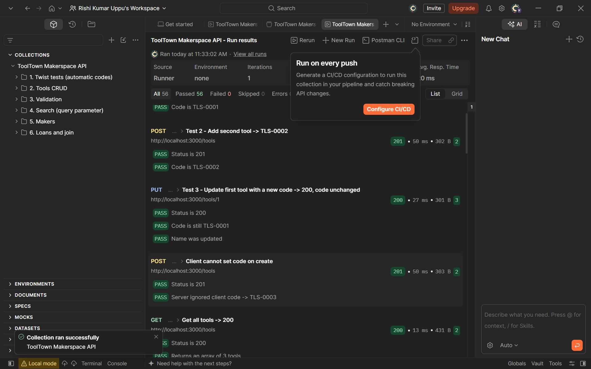

# ToolTown Makerspace API

> "Our tools are borrowed on handshake trust. Drills disappear for weeks and we cannot tell who has what."

A REST API for the ToolTown tool library. It records **makers** (members), **tools**, and **loans** (who borrowed what, and when), so the makerspace always knows who has which tool.

Built with **Node.js**, **Express** and **SQLite** (Node's built-in `node:sqlite` module, so no C++ build tools are needed).

**Group 6 · Section CSE2E · Theme 6: Tool library · Twist: Automatic codes**

---

## How to run

You need [Node.js](https://nodejs.org) **22.13 or newer** (check with `node -v`).

```bash
git clone <your-repo-url>
cd tooltown
npm install
npm start
```

The server starts at **http://localhost:3000**. The database file `tooltown.db` is created automatically on first start.

| Command | What it does |
|---|---|
| `npm start` | Start the server |
| `npm run dev` | Start with auto-restart on file changes (nodemon) |
| `npm run reset` | Delete the database to start fresh (stop the server first) |

## Running the Postman tests

1. Stop the server, run `npm run reset`, then `npm start`. The twist tests expect a **fresh database**, so the first tool gets TLS-0001.
2. In Postman: **Import** → `postman/ToolTown.postman_collection.json`.
3. Right-click the collection → **Run collection** → **Run**.
4. All 32 requests and 56 tests should pass.

Command-line alternative: `npx newman run postman/ToolTown.postman_collection.json`

---

## Database

Three related tables:

```
makers (id, name, email)
   │ 1
   │
   │ many
loans  (id, maker_id → makers.id, tool_id → tools.id, borrowed_at, due_date, returned_at)
   │ many
   │
   │ 1
tools  (id, code, name, kind)
```

- One maker can have many loans, and one tool can have many loans over time.
- `returned_at` is `NULL` while the tool is still out.
- Foreign keys are enforced (`PRAGMA foreign_keys = ON`).

## Endpoints

### Tools

| Method | Route | Success | Errors |
|---|---|---|---|
| GET | `/tools` | 200 | – |
| GET | `/tools?kind=drill` | 200 | – |
| GET | `/tools?name=bosch` | 200 | – |
| GET | `/tools/:id` | 200 | 400 bad id, 404 |
| POST | `/tools` | 201 | 400 |
| PUT | `/tools/:id` | 200 | 400, 404 |
| DELETE | `/tools/:id` | 200 | 404, 409 (tool has loan records) |

Allowed `kind` values: `drill, saw, sander, hammer, screwdriver, wrench, clamp, other`

### Makers

| Method | Route | Success | Errors |
|---|---|---|---|
| GET | `/makers` | 200 | – |
| GET | `/makers/:id` | 200 | 400, 404 |
| POST | `/makers` | 201 | 400, 409 (email already used) |

### Loans

| Method | Route | Success | Errors |
|---|---|---|---|
| GET | `/loans` | 200 (**join**: maker name + tool name) | – |
| GET | `/loans?active=true` | 200 (tools still out) | – |
| GET | `/loans/:id` | 200 | 400, 404 |
| POST | `/loans` | 201 | 400, 404, 409 (tool already out) |
| PATCH | `/loans/:id/return` | 200 | 404, 409 (already returned) |

All errors use one format:

```json
{ "error": "name is required and must be a non-empty string" }
```

## Examples

**Add a tool:** `POST /tools`

```json
{ "name": "Bosch Drill", "kind": "drill" }
```

→ `201 Created`

```json
{ "id": 1, "code": "TLS-0001", "name": "Bosch Drill", "kind": "drill" }
```

**Borrow a tool:** `POST /loans`

```json
{ "maker_id": 1, "tool_id": 1, "due_date": "2026-11-23" }
```

**Who has what:** `GET /loans` (join)

```json
[
  {
    "id": 1,
    "maker_name": "Ravi Kumar",
    "tool_name": "Bosch Drill",
    "tool_code": "TLS-0001",
    "borrowed_at": "2026-11-16 10:05:00",
    "due_date": "2026-11-23",
    "returned_at": null
  }
]
```

---

## Our twist: Automatic codes

The server gives every new tool a code such as **TLS-0001**, then **TLS-0002**. The client cannot set it, and an update never changes it.

How it works (`codes.js`):

1. **Create:** the tool is inserted with only `name` and `kind`. The new row's `id` is turned into a code (`1 → TLS-0001`) with `padStart(4, '0')`, and saved. Both steps run in **one transaction**, so a tool can never exist without its code.
2. **Client can't set it:** any `code` in the request body is ignored. The server only reads `name` and `kind`.
3. **Update never changes it:** the `UPDATE` statement only touches `name` and `kind`. If the client sends a new code, the request still succeeds (200) and the code stays the same.
4. **Never reused:** the `tools.id` column uses `AUTOINCREMENT`, so SQLite never reuses an id, even after a delete. Delete TLS-0003, and the next tool is still TLS-0004.

| Test | Request | Result |
|---|---|---|
| 1 | Add the first tool | 201, code TLS-0001 ✅ |
| 2 | Add the second tool | code TLS-0002 ✅ |
| 3 | Update the first, sending a new code | 200, code unchanged ✅ |

---

## Project structure

```
tooltown/
├── server.js          Part 1  Express setup, mounts routes, 404 + error handler
├── db.js              Part 2  SQLite connection and the 3 tables
├── queries.js         Part 2  All SQL queries (parameterised)
├── routes/
│   ├── tools.js       Part 3  Tools CRUD endpoints
│   ├── makers.js      Part 3  Makers endpoints
│   └── loans.js       Part 3  Loans endpoints + join
├── validation.js      Part 4  Input checks and error messages
├── search.js          Part 4  Search by query parameter (?kind=, ?name=)
├── codes.js           Part 5  Automatic TLS codes (the twist)
├── postman/
│   └── ToolTown.postman_collection.json   Part 6
└── README.md                              Part 6
```

## Test results

All 32 requests and 56 tests pass in the Postman Collection Runner.



## Team

| Part | Member | Files |
|---|---|---|
| 1. Server and routes | Rishi | `server.js`, `package.json`, `.gitignore` |
| 2. Database | Arjun | `db.js`, `queries.js` |
| 3. REST endpoints | Abhiram | `routes/tools.js`, `routes/makers.js`, `routes/loans.js` |
| 4. Validation and search | Shashank | `validation.js`, `search.js` |
| 5. Twist rule | Pravalika | `codes.js` |
| 6. Postman and README | Manivardhan | `postman/ToolTown.postman_collection.json`, `README.md` |
